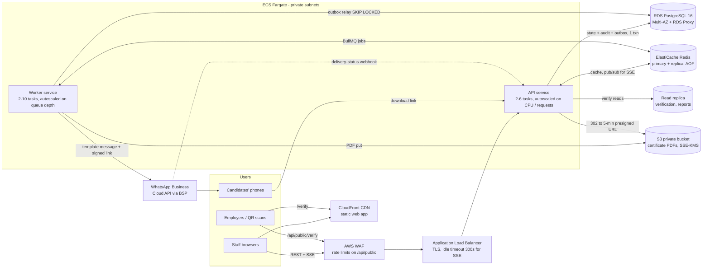

# CertiFlow: production deployment plan

**Load to plan for**
- 100,000 registered users, about 10,000 daily active.
- **Results-day peak:** 500 batches approved in one hour, which means **30,000 PDFs and 30,000 WhatsApp messages in one hour** (about 8.3 per second on average, arriving in bursts).
- Public verification: thousands of lookups a day, in bursts.

The code that runs locally in Docker Compose is the code that runs in production. Only the managed services and the number of instances change.

## 1. Architecture

**How events flow**
1. The final approval commits `status=APPROVED`, an audit row and an **outbox row**, all in one transaction.
2. The worker relay claims outbox rows (`FOR UPDATE SKIP LOCKED`), enqueues `issue-batch` (job id = batch id) and publishes a realtime notice on Redis pub/sub.
3. The issuance job inserts one certificate per candidate (`ON CONFLICT DO NOTHING`) and enqueues one `deliver-certificate` job per certificate (job id = certificate id).
4. The delivery job renders the PDF to S3 if missing, sends the WhatsApp template with the signed link (idempotency key = certificate id), and marks it `SENT`. Failures are retried with capped exponential backoff and jitter. After the last attempt the certificate is marked `FAILED` and the state office is alerted.
5. Every API instance forwards pub/sub notices to its SSE clients, and browsers refetch.

## 2. Where each component runs, and why

**Region: AWS Mumbai (ap-south-1).** It keeps candidate personal data in India (DPDP Act) and gives the lowest latency to users.

| Component | Hosted on | Why |
|---|---|---|
| Web app (static React build) | **S3 + CloudFront** | No servers, cached at the edge, almost free |
| API | **ECS Fargate** behind an **ALB**, 2 tasks minimum across 2 AZs | Stateless containers (same image as local); no hosts to patch; ALB supports long-lived SSE |
| Workers | **ECS Fargate**, separate service, same image, `node dist/src/worker.js` | Scales independently of the API, on queue depth rather than HTTP load |
| PostgreSQL | **RDS PostgreSQL 16, Multi-AZ**, plus **RDS Proxy** and **1 read replica** | The correctness guarantees (unique keys, sequence, row locks, outbox) live here, so it gets automatic failover and PITR backups. The proxy absorbs connections from many tasks. The replica serves verification bursts. |
| Redis | **ElastiCache for Redis**, primary + replica, Multi-AZ, AOF | Queues, cache and pub/sub. Managed failover. |
| Certificate PDFs | **S3**, private, SSE-KMS, versioning on | Durable and cheap. Never public (see section 5). |
| WhatsApp | **WhatsApp Business Cloud API** through a BSP (e.g. Gupshup or Twilio) | An approved *utility* template "certificate_issued" with a link button |
| Secrets | **AWS Secrets Manager** (`JWT_ACCESS_SECRET`, `CERT_LINK_SECRET`, DB credentials, WhatsApp token) | Injected as ECS task secrets; rotated without rebuilding images |
| Migrations | ECS one-off task running `prisma migrate deploy` in the deploy pipeline, before new tasks start | Same command as the local `migrate` service |

**CI/CD:** GitHub Actions does the following on each merge to `main`:
1. Run `docker compose --profile test run tests`.
2. Build the images and push them to ECR.
3. Run the migration task.
4. Do a rolling ECS deploy (minimum healthy 100%, health check `/api/health`).

## 3. Scaling

### What scales horizontally
- **API tasks:** stateless, since scope is read from the signed token, SSE is fanned out through Redis pub/sub, and files live in S3. Autoscale on CPU above 60% or ALB requests per target. The usual size is 2 tasks; results day is 4–6.
- **Worker tasks:** every job is idempotent and claimed atomically, so you can add or remove any number at any time. Autoscale on the BullMQ `delivery` waiting count (published to CloudWatch every 30 s by a small metrics job): scale out above 500 waiting, scale in below 50.
- **Outbox relays:** one per worker. `SKIP LOCKED` lets them share the table safely.

### Throughput at peak, and what limits it

| Step | Cost per certificate | Capacity per worker task (1 vCPU, concurrency 10) | For 30k/hour (8.3/s) |
|---|---|---|---|
| PDF render (pdfkit + QR) + S3 put | about 60–100 ms CPU, ~150 KB | about 10–15/s | **2 tasks** steady; run 4–6 on results day to absorb bursts |
| WhatsApp send | mostly network wait (~200–800 ms) | concurrency-bound, cheap | bounded by **WhatsApp limits** below |
| Database writes | ~5 small writes (insert, 3 updates, audit) | — | ~42 writes/s, which is trivial for RDS |

**The real limits are WhatsApp's, not ours:**
1. **Messaging limit tier.** Meta caps business-initiated messages to *unique users per rolling 24 h* (1K → 10K → 100K → unlimited). Results day needs **30,000 unique recipients**, so the number must be at the **100K tier before results day**. Meta upgrades the tier automatically with sustained volume and good quality, so plan the ramp-up weeks ahead. This is an operational launch checklist item.
2. **Throughput:** the Cloud API allows about 80 messages/s by default, which is ~10× our need. The worker's BullMQ limiter (50/s across *all* workers, set in code) keeps us under provider and BSP limits.

**Clearing the backlog:** 30,000 jobs is about 6 MB in Redis, so a backlog is cheap to hold. With 6 worker tasks at ~10/s each, an hour's peak clears in **about 8 minutes**. During a WhatsApp outage, PDFs are still generated and messages wait with capped backoff (at most 5 minutes between attempts). When the provider recovers, the backlog drains at the rate limit: 30k / 50 per second is about **10 minutes**.

### Verification bursts
- The result is cached in Redis for 30 s and **deleted on revoke**. A QR-scan spike for one certificate hits the database once.
- Cache misses go to the **read replica**. Replica lag is usually under a second, but a revocation must never read stale, so revoke deletes the cache key *after* the primary commits, and the next miss reads the replica. If lag ever matters, verification of a key deleted in the last 5 s reads the primary.
- WAF rate limit: 300 requests per 5 minutes per IP on `/api/public/*`, plus the in-app limiter (switched to a Redis store in production so it counts across instances).

## 4. Failure handling

| Failure | What happens | Why nothing is lost or duplicated |
|---|---|---|
| **A worker crashes mid-job** | BullMQ marks the job *stalled* when its lock expires (~30 s) and another worker picks it up. ECS replaces the task. | Jobs are idempotent. Issuance uses `ON CONFLICT DO NOTHING` on the unique candidate. Delivery skips `SENT` certificates. PDFs are written to a temp key and then moved. A crash after the provider accepted a message but before we recorded `SENT` is covered by the idempotency key, or in production by checking the delivery-status webhook record before re-sending. |
| **An API instance crashes** | The ALB health check removes it and ECS replaces it. Browsers' SSE reconnects to another instance automatically (`retry: 3000`). | Every write is one transaction: state, audit and outbox commit together or not at all. |
| **Redis restarts or fails over** | ElastiCache promotes the replica (~30–60 s). During the gap the API keeps serving (the cache falls back to Postgres), enqueueing pauses, and the outbox relay keeps rows unpublished and retries. Workers reconnect and continue. | **Approvals are never lost**, because the event is in Postgres (outbox) until it is safely queued. AOF (`appendfsync everysec`) loses at most ~1 s of queue writes. To recover even that, production adds a **reconciliation sweep** (every 10 minutes: approved batches whose certificates are missing or still `PENDING` after 15 minutes get re-enqueued). This is **not built yet** (see README, Known limitations); re-running issuance for a batch already does it by hand. |
| **WhatsApp outage** | Sends fail and are retried with capped exponential backoff and jitter, up to 8 attempts over ~25 minutes. After that the certificate is `FAILED`, the state office gets an alert, and "Resend" re-queues it. A CloudWatch alarm on failure rate pages on-call. | Certificates are already issued and verifiable during the outage; only the message is late. Candidates can also be given the verify page. |
| **Slow database** | RDS Proxy queues connections instead of exhausting them. Statement timeout is 5 s for API requests and longer for workers. Verification is served from the Redis cache and the read replica. Workers slow down and the queue grows; nothing is dropped. | Alarms on p95 latency and CPU trigger scale-up (instance class) or investigation with `EXPLAIN ANALYZE` (the hot paths are indexed: batches by `(districtId, status)` and `(status, stageEnteredAt)`, certificates by `batchId`). |
| **Whole AZ lost** | Multi-AZ RDS fails over; ElastiCache and ECS tasks run in 2 AZs. | Same as above. |

## 5. Certificate file storage and access control
- PDFs live in a **private S3 bucket** under `certificates/<certificateId>.pdf`, encrypted with SSE-KMS, with versioning on (a re-render can never silently replace evidence) and Block Public Access on.
- **No one gets a bucket URL directly.** The WhatsApp message contains `https://api…/public/certificates/<number>/pdf?sig=<HMAC(certificateId)>`. The API:
  1. checks the signature in constant time;
  2. refuses **revoked** certificates (`410`);
  3. answers with a **302 to a 5-minute S3 presigned URL**. (Locally it streams the file from the shared volume instead.)
- Staff never download PDFs in bulk. They see certificate metadata, scoped to their centre or district.
- Lifecycle: move to S3 Standard-IA after 90 days. Certificates are kept for the programme's retention period; revoked ones are kept as evidence.
- The worker task role may `PutObject` and `GetObject` only under `certificates/`. The API role may only `GetObject`, which is needed to sign URLs.

## 6. Monitoring and alerting
**Logs:** structured pino JSON goes to CloudWatch Logs. Each line carries `reqId`, and jobs carry the `requestId` of the approval that triggered them, so one approval can be traced from the HTTP request through the outbox, issuance and every delivery. The audit trail in Postgres is the business-level record for "what happened to batch X".

**Metrics** (CloudWatch, via an OpenTelemetry collector sidecar):
- API p50/p95 latency and 5xx rate per route.
- **Queue depth and age** for `issuance` and `delivery`, delayed and failed counts.
- **Outbox lag:** the age of the oldest unpublished row.
- **Delivery failure rate** (provider 5xx and timeouts).
- **Stuck batches** count.
- RDS CPU, connections and replica lag; Redis memory and evictions (must stay 0).

**Alerts** (SNS to on-call, plus an email to the programme office for business alerts):

| Alert | Condition | Severity |
|---|---|---|
| Outbox lag | > 60 s | Page: approvals aren't turning into certificates |
| Delivery queue age | Oldest waiting > 15 min on a results day | Page |
| WhatsApp failure rate | > 20% for 5 min | Page; usually a provider outage |
| Certificates `FAILED` | > 0 in an hour | Ticket, plus the in-app alert to the state office |
| API 5xx | > 1% for 5 min, or p95 > 1 s | Page |
| Redis evictions | > 0 | Page: queue data at risk (`maxmemory-policy noeviction` is required) |
| RDS | CPU > 80% for 10 min, free storage < 20%, replica lag > 5 s | Ticket or page |
| Business: stuck batches | > 20 at once | Email to the state office |

## 7. Rough monthly cost (ap-south-1, on-demand, USD)

| Item | Size | ~$/month |
|---|---|---|
| ALB + WAF | 1 ALB, 1 web ACL | 35 |
| ECS Fargate: API | 2 × (0.5 vCPU, 1 GB) 24/7; more on peak days | 35 |
| ECS Fargate: workers | 2 × (1 vCPU, 2 GB) 24/7; peak bursts to 6–10 for a few hours | 75 |
| RDS PostgreSQL | db.t4g.medium Multi-AZ, 100 GB gp3, RDS Proxy, 1 × db.t4g.small replica | 230 |
| ElastiCache Redis | cache.t4g.small primary + replica | 50 |
| S3 + KMS | ~15 GB added per month (8k–30k PDFs at ~150 KB) | 5 |
| CloudFront | Web app and verify page | 10 |
| NAT gateway | 1 (data processing is small) | 40 |
| CloudWatch | Logs (30-day retention), metrics, alarms | 30 |
| Secrets Manager, ECR, backups | — | 15 |
| **Infrastructure total** | | **≈ $525 / month (≈ ₹44,000)** |
| WhatsApp utility messages | ~8,000/month normally, at about ₹0.12–0.15 each plus BSP markup; results days add ~30,000 | ≈ ₹1,500–6,000 / month |

**Trade-offs behind it**
- **Multi-AZ RDS is about 45% of the bill**, and it is deliberate. Every guarantee (no duplicate certificates, no double approvals, no lost events) lives in Postgres. Staging can run single-AZ for half the price.
- **Fargate over EC2/Kubernetes:** slightly more per vCPU, but no node management. At this size, EKS's control plane ($73) and the operational work outweigh any savings.
- **Redis instead of SQS/Kafka:** one managed component does queues, cache and pub/sub. SQS would remove the Redis-durability concern but adds a second system and loses BullMQ's rate limiter and repeatable jobs. If Redis durability ever becomes a worry, the outbox and the reconciliation sweep already make Redis rebuildable from Postgres.
- **Cheaper option** for a pilot (fewer than 1,000 certificates a month): one EC2 t4g.medium running the same `docker-compose.yml` plus RDS single-AZ, for about $90/month. You lose HA but nothing in the code changes.
- **Savings plans or reserved instances** for RDS, ElastiCache and baseline Fargate cut roughly 30–40% once the load is known.
